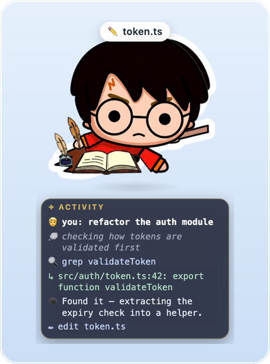
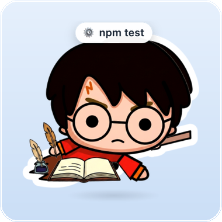

<div align="center">

# Opencode Scrybe Pet

**A desktop pet for [opencode](https://opencode.ai) that _scries_ your session and _scribes_ it live.**

A little wizard on a broom perches on top of your screen and shows what your
agent is doing, in real time - streaming reasoning and replies, every tool call
and its output, plans, permissions, and the final result. He reacts as work
happens and dozes off when opencode isn't running.



</div>

## Modes

The character itself changes with the work - not just a badge on top.

<div align="center">
<table>
  <tr>
    <td align="center" width="25%"></td>
    <td align="center" width="25%"></td>
    <td align="center" width="25%"></td>
    <td align="center" width="25%"></td>
  </tr>
  <tr>
    <td align="center"><b>idle</b><br/><sub>calm hover</sub></td>
    <td align="center"><b>thinking</b><br/><sub>eyes up, pondering</sub></td>
    <td align="center"><b>working</b><br/><sub>heads-down + live action</sub></td>
    <td align="center"><b>sleeping</b><br/><sub>opencode disconnected</sub></td>
  </tr>
</table>
</div>

## Features

- **Live relay.** A transcript panel streams the session as it happens - your
  prompt, the model's **reasoning** and **response** (streaming, updating in
  place), each tool call with its target, and the tool **output**.
- **Live status bubble.** The current action + target at a glance:
  `✏️ token.ts`, `⚙️ npm test`, `🔍 TODO`, `📝 3/5 done`, `❓ allow bash?`.
- **Custom per-mode art.** Distinct artwork for thinking, working, and sleeping,
  with a mood colour-grade and its own flight motion.
- **Auto wake / sleep.** Follows the desktop app, not the background service.
  The pet appears when you open the app, vanishes when you close it, and comes
  back when you reopen it. The stale-heartbeat timeout is only the fallback if
  the plugin cannot close it first.
- **Stays put & draggable.** Sits where you leave him; drag to reposition
  (remembered across restarts).
- **Sound, sizing, and a right-click menu.** Completion chime (mutable), four
  sizes, toggle the log, reset position, quit.

## How it works

```
opencode ──(plugin)──► ~/.cache/opencode-pet/state.json ──(watch)──► Electron overlay
```

- **`plugin/pet.ts`** - an opencode plugin (Node built-ins plus this repo's
  `shared/` modules). It hooks into
  session / tool / message events, keeps a rolling relay of the recent steps and
  the streaming reasoning/response, and writes it (throttled) to a small state
  file. While the desktop app is open it pulses a heartbeat and launches the
  overlay; when the app closes it deletes the heartbeat and closes the pet.
- **`app/`** - a transparent, always-on-top Electron window. The character is a
  raster sprite animated with CSS; each mood swaps the sprite and layers motion,
  a colour-grade, and overlays. Click-through everywhere except the character.

The overlay and plugin talk only through files in `~/.cache/opencode-pet/`, so
there are no ports and nothing to configure.

## Install

Requires [opencode](https://opencode.ai) **2.x** (the V2 desktop app) and
[Node.js](https://nodejs.org). This fork's plugin uses the V2 plugin contract,
so OpenCode 1 will not load it.

```sh
git clone https://github.com/g3saranath/opencode-pet.git ~/opencode-pet
cd ~/opencode-pet
npm install                                     # downloads Electron
```

Then register the plugin with opencode (global). Create
`~/.config/opencode/plugin/pet.ts` as a small shim that points at your clone:

```ts
export { default } from "file:///Users/you/opencode-pet/plugin/pet.ts?v=1";
```

Use the absolute path to your clone as a `file://` URL (three slashes, forward
slashes). On Windows it looks like
`file:///D:/Projects/opencode-pet/plugin/pet.ts?v=1`.

Then **restart opencode**. Scrybe appears automatically and starts relaying the
session. (Plugins load only at startup, so restart after any change.)

> **Shim, don't symlink.** The real plugin is `plugin/pet.ts` in your clone and
> it imports this repo's `shared/` modules. OpenCode V2 reads the entry file
> itself and does not follow a symlink placed there, so a symlinked `pet.ts`
> fails to load with "Plugin must export a default definition". The shim is a
> real file that re-exports the clone, so the plugin and its imports still
> resolve back to the repo. Copy the plugin file itself only if you also copy
> `shared/`.

> After editing the plugin, bump the `?v=` number and restart opencode to pick
> up the new code.

> Prefer not to auto-launch on session start? Set `OPENCODE_PET_NO_LAUNCH=1` and
> run the overlay yourself with `npm start`.

## Controls

| Action        | How                                                     |
| ------------- | ------------------------------------------------------- |
| Move          | Left-click and drag                                     |
| Menu          | **Right-click** - Size, Mute, Activity log, Reset, Quit |
| Resize        | Right-click ▸ Size ▸ Small / Medium / Large / Huge      |
| Mute sounds   | Right-click ▸ Mute sounds                               |
| Show/hide log | Right-click ▸ Show activity log                         |
| Quit          | Right-click ▸ Quit, or `Ctrl`+`Alt`+`Shift`+`P`         |
| Run manually  | `npm start`                                             |

## Configuration

| Variable                   | Effect                                                             |
| -------------------------- | ----------------------------------------------------------------- |
| `OPENCODE_PET_DIR`         | Path to this checkout (defaults to the checkout the plugin lives in) |
| `OPENCODE_PET_NO_LAUNCH=1` | Don't auto-launch the overlay from the plugin                     |

Runtime files live in `~/.cache/opencode-pet/`: `state.json` (current relay),
`heartbeat` (connection pulse), `owner.pid` (which plugin instance drives the
pet), `pet.pid` (overlay pid), `pos.json` (position), `config.json` (size / mute /
log preferences).

## For AI agents and other IDEs

Built for OpenCode, but the overlay is just a file watcher. Any agent or IDE
can drive the wizard by writing the same two files in `~/.cache/opencode-pet/`:

- `state.json`: `{ state, feed }` where `state` is one of
  `idle | thinking | working | waiting | happy | error | sleeping` and `feed`
  is an array of `{ seq, icon, text, kind }`. See `shared/state-protocol.js`
  as the reference (atomic write via `state.json.tmp` rename, deduped, with `ts`).
- `heartbeat`: `"<timestamp> <pid>"` updated every few seconds while the agent
  is alive. Delete it and write `state: sleeping` on shutdown so the pet
  naps and then quits.

Minimal example (adjust the path to point at your clone):

```js
const { createStateWriter } = require("/path/to/opencode-pet/shared/state-protocol");
const writeState = createStateWriter();
writeState("working", { detail: "edit token.ts" },
  [{ seq: 1, icon: "\u270F\uFE0F", text: "edit token.ts", kind: "step" }]);
```

The `heartbeat` pid is used to tell whose pulse it is: the overlay checks that
the process is still alive, so a crashed agent can't keep the pet awake by
leaving a fresh timestamp behind. Write your own `process.pid` there.

No ports or extra config. Just write the files and the wizard reacts. PRs for
other adapters are welcome.

## Swapping the art

The character lives in `app/renderer/` as `sprite.png` (idle / fallback) plus
`sprite-thinking.png`, `sprite-working.png`, and `sprite-sleeping.png`. Each is
used for its state and falls back to `sprite.png` when absent. Drop in your own
square, transparent-background PNGs with the same names and restart the overlay.

## Platform

Built and tested on macOS (Apple Silicon). It uses standard Electron overlay
APIs, so Linux / Windows should work with minor tweaks - PRs welcome.

Auto wake / sleep reads the desktop process image, which is wired up for
Windows (`OpenCode.exe`). On macOS and Linux it falls back to staying awake
while opencode runs, so the pet will not auto-vanish when you close the app
there yet.

## Contributing

Issues and PRs are welcome. The code is deliberately small and dependency-light
(one Electron dependency for the app; the plugin uses only Node built-ins plus
this repo's `shared/` modules - no npm packages at runtime).

## License

[MIT](LICENSE) © g3saranath

## Notice

The bundled character art is fan art of a well-known wizard-on-a-broom character.
This project is **not affiliated with, endorsed by, or associated with** Warner
Bros., J.K. Rowling, or the Harry Potter franchise, and is shared for
non-commercial, personal use only. All related trademarks and copyrights belong
to their respective owners. Swap in your own artwork (see **Swapping the art**)
if you prefer.
